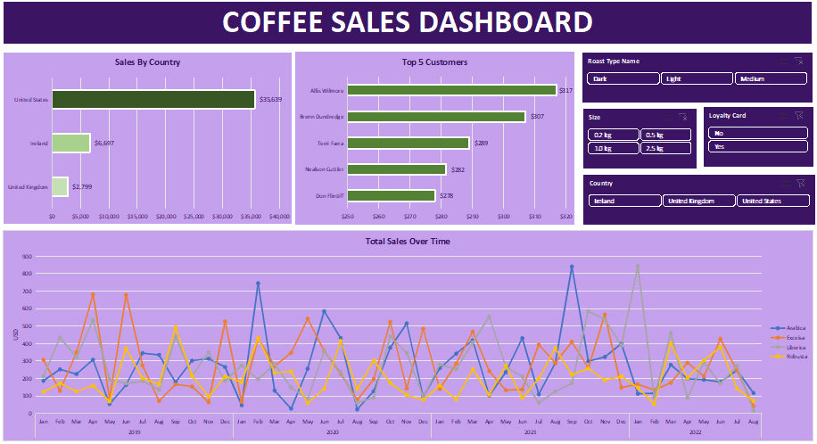
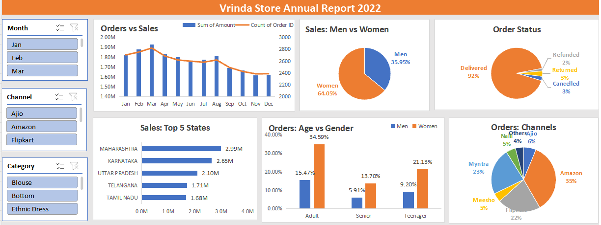
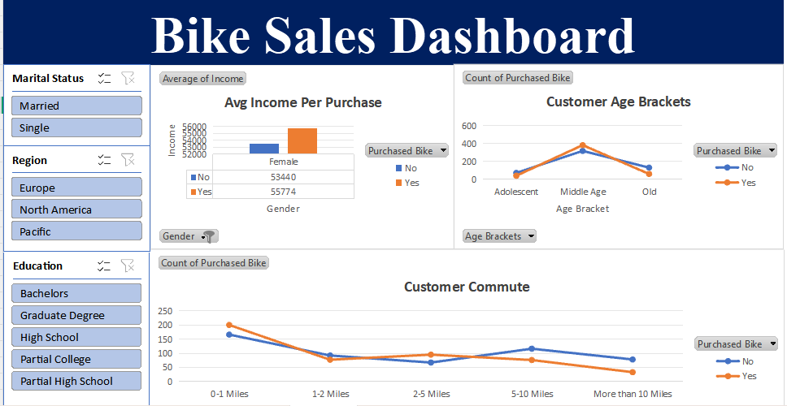

# 📊 Excel Dashboard Projects

Three hands-on Excel projects where I cleaned raw data, analyzed it with Pivot Tables, and built interactive dashboards with slicers.

**Tools used:** Microsoft Excel — Pivot Tables, Pivot Charts, Slicers, XLOOKUP, INDEX-MATCH, nested IF, TEXT, Remove Duplicates

---

## ☕ 1. Coffee Sales Dashboard

**What I learned**
- Combining data from multiple sheets (orders, customers, products) using **XLOOKUP**.
- Creating a **Sales column** with a formula (Unit Price × Quantity).
- Converting short codes (Rob, Ara, M, D…) into readable names with **nested IF**.
- Building **Pivot Charts** for sales by country, top 5 customers, and sales over time (a line chart for trends, bars for rankings).
- Adding **slicers** (roast type, size, loyalty card, country) that filter the whole dashboard at once.

🎥 Tutorial: [YouTube](https://youtu.be/m13o5aqeCbM)

---

## 👗 2. Vrinda Store Sales Analysis (2022)

**What I learned**
- Working with a large dataset (31,000+ orders) and turning it into a business story.
- Creating an **Age Group** column using nested IF and a **Month** column using the `TEXT` function.
- Using Pivot Tables to compare **sales vs. orders**, and **% of total** to compare categories.
- Choosing the right chart: pie for share, bar for ranking, combo chart for sales vs. orders.
- Finding insights: women (~64%), adults aged 30–49 (~50%), Maharashtra / Karnataka / Uttar Pradesh (~36%), and Amazon / Flipkart / Myntra (~80%) drive most of the sales.
- Ending with a clear **recommendation** the store owner can act on.

🎥 Tutorial: [YouTube](https://youtu.be/gTK5rNhWJyA)

---

## 🚲 3. Bike Sales Dashboard

**What I learned**
- **Data cleaning:** work on a copy of the raw data, remove duplicates (1,026 → 1,000 rows), and use Find & Replace to make labels readable (M/S → Married/Single, M/F → Male/Female).
- Grouping exact ages into *Adolescent, Middle Age,* and *Old* with a **nested IF**.
- Picking the right rows, columns, and values (count vs. average) in Pivot Tables.
- Connecting **one slicer to multiple pivot tables** so the whole dashboard filters together.
- **Dashboard design:** clear header, removed gridlines, aligned charts.
- Insights: middle-aged customers buy the most bikes, purchases drop as commute distance increases, and buyers earn slightly more on average.

🎥 Tutorial: [YouTube](https://youtu.be/opJgMj1IUrc)

---

## 🎯 Overall Skills Gained
- Data cleaning and preparation
- Formulas: `XLOOKUP`, `INDEX-MATCH`, nested `IF`, `TEXT`
- Pivot Tables & Pivot Charts
- Interactive dashboards with slicers
- Turning data into insights and recommendations
